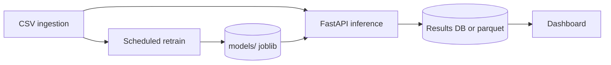

# Phase 1 dashboard — training evaluation (no ingestion yet)

This is how to build the **university network monitoring dashboard** before the CSV ingestion pipeline exists. The UI reads **exported evaluation results** from the same model as `user_classification.ipynb`. Later, you swap the data source for live inference + retraining without changing the layout.

Inspired by [Shadcn Dashboard 8](https://www.shadcnblocks.com/block/dashboard8): collapsible sidebar, stat cards, charts, searchable sortable table.

---

## 1. What you are showing (Phase 1)

| Question | Answer on the dashboard |
|----------|-------------------------|
| Is the model behaving badly on held-out data? | **Green / yellow / red** banner from anomaly counts |
| How many issues? | Cards: **normal**, **maybe**, **high-confidence** |
| Show me a wrong prediction | Table row: true **Fiscal**, predicted **Admin**, with flow fields to investigate |
| How wrong is the model overall? | Accuracy + top confusion pairs (Fiscal → Admin, etc.) |

Phase 1 uses the **50% test split** from the notebook (labels known). That is intentional: you need `true_userclass` to define “abnormal” as **misclassification**.

---

## 2. Define “anomaly” (aligns with your traffic light)

On each **test** row:

1. Run `predict` and `predict_proba` (Random Forest).
2. `is_misclassified = predicted_userclass != true_userclass`
3. `max_probability = max(predict_proba)`

| Tier | Rule | UI color | Meaning for IT |
|------|------|----------|----------------|
| **Normal** | Prediction matches true label | (feeds green) | Model agrees with ground truth |
| **Maybe** | Misclassified and `max_probability < 0.85` | **Yellow** | Wrong class, but model was not very sure — review if needed |
| **High-confidence anomaly** | Misclassified and `max_probability ≥ 0.85` | **Red** | Wrong class while model was confident — priority review |

**Overall status** (banner):

- **Green**: `high_confidence_anomaly == 0` and `maybe_anomaly == 0`
- **Red**: `high_confidence_anomaly > 0`
- **Yellow**: only `maybe_anomaly > 0` (no red)

Thresholds `0.85` / `0.55` live in config; tune with your team.

Example you care about: **true Fiscal, predicted Admin** → appears in the **Anomalies** table with `max_probability`; tier is red if the model was ≥ 85% sure of Admin.

---

## 3. Generate static data (do this first)

From the repo root:

```bash
python scripts/export_dashboard_snapshot.py
```

Outputs:

| File | Purpose |
|------|---------|
| `dashboard/data/summary.json` | Status, counts, thresholds, definitions |
| `dashboard/data/anomalies.json` | All misclassified test rows + display fields |
| `dashboard/data/metrics.json` | Accuracy, top true→predicted pairs |

Re-run after retraining or when you change thresholds in the script.

Optional: add matching cells at the end of `user_classification.ipynb` that call the same logic so the notebook and script stay in sync.

---

## 4. Dashboard layout (Dashboard 8 style, SCIPE context)

### 4.1 Tech stack

| Layer | Choice |
|-------|--------|
| UI | **Next.js** + **shadcn/ui** + **Tailwind** (same ecosystem as Dashboard 8) |
| Charts | **Recharts** (bar, line, heatmap for confusion matrix) |
| Table | shadcn **DataTable** — sort, filter, search |
| Phase 1 API | **FastAPI** serves `dashboard/data/*.json` **or** Next.js reads JSON from `public/data/` at build time |
| Phase 2+ | FastAPI runs inference on `/data/in`, retrains on schedule, same routes |

### 4.2 Sidebar (university network monitoring)

- **Overview** — status banner + count cards + accuracy
- **Anomalies** — misclassification table (default filter: red + yellow)
- **Class confusion** — heatmap / top pairs (Fiscal vs Admin)
- **Flow detail** — opens from row click (drawer or `/anomalies/[row_id]`)
- **Model** — version, last trained, feature list (from `metrics.json` + future `metadata.json`)
- *Later:* **Live ingest** — file list from pipeline (disabled until connected)

### 4.3 Overview page (maps to Dashboard 8 “stat cards”)

1. **Network classification health** — large badge: Green / Yellow / Red (`summary.status`)
2. Four cards:
   - Non-anomalies (`counts.normal`)
   - Maybe anomalies (`counts.maybe_anomaly`)
   - High-confidence anomalies (`counts.high_confidence_anomaly`)
   - Test flows evaluated (`counts.rows_total`)
3. Secondary row: test accuracy, last export timestamp
4. Chart: bar chart of anomaly count by `true_userclass`

### 4.4 Anomalies table (maps to “invoices table”)

Columns:

| Column | Example |
|--------|---------|
| Tier | badge Red / Yellow |
| True class | Fiscal |
| Predicted class | Admin |
| Confidence | 0.91 |
| srcIP / srcPort / dstPort | … |
| Actions | **View flow** |

**View flow** opens a side sheet with **every original CSV field** for that `row_id` (load from a fuller export later if needed; Phase 1 uses display columns in `anomalies.json`).

Filters:

- Tier: All / Red / Yellow
- True class / Predicted class dropdowns
- Search on IP or port

---

## 5. Phase 1 API (minimal)

Even without ingestion, a thin API keeps the same contract for Phase 2.

| Method | Path | Returns |
|--------|------|---------|
| `GET` | `/api/v1/dashboard/summary` | `summary.json` |
| `GET` | `/api/v1/dashboard/anomalies` | `anomalies.json` (optional query: `tier=high`) |
| `GET` | `/api/v1/dashboard/anomalies/{row_id}` | Single row (add full-row export in script if needed) |
| `GET` | `/api/v1/dashboard/metrics` | `metrics.json` |

FastAPI implementation: read JSON files from `dashboard/data/`. No model load required in Phase 1.

Nginx: serve Next.js static export or proxy to Next dev server; `location /api/` → FastAPI.

---

## 6. Phase 2 — ingestion + dynamic model (later)

When the pipeline mounts CSVs into `/data/in`:



| Change | Behavior |
|--------|----------|
| **Labels** | Production rows may have no `userclass`; anomalies become **low confidence** or **outlier score**, not misclassification |
| **Retrain** | Job retrains on labeled data, bumps `metadata.json` version, API hot-reloads artifacts |
| **Dashboard** | Same cards and table; add **data source** badge: “Evaluation (test set)” vs “Live (2026-03-01 batch)” |
| **Overview** | Green/yellow/red computed on **latest batch** the same way as Phase 1 logic |

Keep one function, e.g. `classify_rows(df) -> summary + row_flags`, used by export script, batch inference, and retrain evaluation.

---

## 7. Implementation order

1. Run `export_dashboard_snapshot.py` and inspect JSON.
2. Scaffold Next.js + shadcn (clone Dashboard 8 block or build sidebar + cards manually).
3. Wire Overview to `summary.json` + `metrics.json`.
4. Build Anomalies table from `anomalies.json`; row drawer for Fiscal/Admin-style review.
5. Add FastAPI file server + Docker Compose + Nginx (from `FLOW_CLASSIFICATION_API.md`).
6. When ingest exists: add `/classify/folder` and point Overview at latest run; schedule retrain.

---

## 8. Notebook tweak (recommended)

Change the train/test split to keep **row indices** so exports join back to full flow fields (the export script already does this with `train_test_split(indices, ...)`). If you only split `X` and `y` in the notebook, you cannot recover original rows for the anomaly table without re-running the split the same way.

---

## 9. Success criteria (Phase 1)

- [ ] IT user sees **green/yellow/red** from test-set anomaly counts.
- [ ] Three counts match `summary.json`.
- [ ] Clicking a misclassified row shows **true vs predicted** and enough flow fields to investigate.
- [ ] UI feels like a **monitoring dashboard** (sidebar, cards, table), not a notebook.
- [ ] Same UI structure ready for **live data** by changing API backend only.
